  <picture></picture>

  
  <picture></picture>

  <picture></picture>

### 👋 About me

I'm a Software Development Team Lead with **5+ years of experience** building scalable, production-grade systems. I lead a team of **6+ engineers at Teamso**, an HR platform, where I own sprint planning and delivery and architect microservices on Spring Boot, AWS and Kubernetes. Outside of work I build products end to end across web, mobile and desktop, and lately a lot of AI agents.

  <picture></picture>

### 💼 Experience

  <picture></picture>

<b>What I did in each role</b>

 

**Software Team Lead, Teamso** · 2024 - Present
- Leading a 6-person engineering team, managing sprint planning and delivery with Scrum
- Architecting microservices-based backend systems with Spring Boot, AWS and Kubernetes

**Software Developer, Teamso** · Aug 2021 - Jan 2024
- Developed full stack web applications with Java (Spring Boot) and Vue.js
- Optimized database queries and implemented Redis caching strategies

**Full-Stack Developer, BCM Makina & Kimya** · Jan 2021 - Aug 2021
- Developed industrial web applications with C# (.NET 5) and Angular
- Designed and implemented a microservices architecture with REST API integrations

**Developer, Piri Medya** · Mar 2020 - Jul 2020
- Developed web-based media and news platforms with HTML, CSS, JavaScript and Java
- Optimized CMS workflows to make content uploads more efficient

### 🛠️ Tech stack

  <picture></picture>

<b>🧠 Core competencies</b>

 

- **Leadership:** team leadership, Scrum, sprint planning and delivery, code review and mentoring
- **Architecture:** microservices, software architecture and system design, monorepos with shared packages, multi-tenant design
- **Backend & APIs:** Java with Spring Boot, Spring Security and JPA, C# with ASP.NET and .NET, Node.js with Hono, REST API design, JWT authentication
- **Frontend:** Vue.js and Nuxt, React and Next.js, Angular, Pinia, Zustand, TanStack Query, Tailwind CSS
- **Mobile & desktop:** React Native with Expo, Flutter with Riverpod, WPF for Windows
- **Data:** PostgreSQL, MySQL, SQLite, Redis caching, query optimization
- **Cloud & DevOps:** AWS, Kubernetes, Docker, GitHub Actions
- **Quality:** Jest, Vitest, Testing Library and Maestro, linting and type checks in CI
- **AI:** Claude Agent SDK, Model Context Protocol (MCP) servers, agentic coding workflows

<b>🌐 Industries & products</b>

 

| Sector | What I built |
| :-- | :-- |
| 👥 **HR Tech / Workforce SaaS** | Web, API and mobile apps for leave, approvals, goals and payslips, plus an MCP server that connects AI assistants to HR data |
| 🏭 **Industrial manufacturing** | Industrial web applications and microservices with REST integrations |
| 📰 **Media & news** | Web-based news and media platforms and CMS workflows |
| 🎓 **E-learning** | A multi-tenant learning management system with role-based access and JWT auth |
| 🖥️ **Digital signage & licensing** | A Windows desktop app, an ASP.NET licence server with trials and payments, and customer and operator panels |
| 🏢 **Property management** | An apartment and site management platform with dues tracking and dashboards |
| 🛒 **Food & FMCG** | A monorepo with a web app, a mobile app and an API sharing core packages |
| 📺 **Streaming** | A cross-platform IPTV player for mobile, desktop, web and Android TV in 11 languages |
| ✈️ **Travel** | An offline-first trip planner with flights, hotels, places and day-by-day routes |
| 💪 **Health & fitness** | An offline-first training and nutrition tracker |
| 🤖 **AI & automation** | An autonomous agent team (analyst, product owner, developers, QA) working through Jira behind CI gates |

<b>🎓 Education</b>

 

- **Yeditepe University:** BS, Computer Engineering (2021 - Present), member of the Competitive Programming Team
- **Marmara University:** Computer Programming (2019 - 2021), GPA 3.55 / 4.00
- **Volunteering:** Education Volunteer at TEGV, Educational Volunteers Foundation of Turkey (2020 - 2021)

🇹🇷 <b>Türkçe</b>

 

**5+ yıllık deneyime** sahip, ölçeklenebilir ve canlı ortamda çalışan sistemler geliştiren bir Yazılım Geliştirme Takım Lideriyim. Bir İK platformu olan **Teamso'da 6+ kişilik bir mühendis ekibini** yönetiyorum; sprint planlama ve teslim süreçlerinden sorumluyum, Spring Boot, AWS ve Kubernetes üzerinde mikroservis mimarileri tasarlıyorum. İş dışında web, mobil ve masaüstünde ürünleri uçtan uca geliştiriyorum, son zamanlarda da bolca AI agent.

**Deneyim**
- **Teamso, Yazılım Takım Lideri** (2024 - Günümüz): 6 kişilik ekibi Scrum ile yönetiyorum; Spring Boot, AWS ve Kubernetes ile mikroservis tabanlı backend sistemleri tasarlıyorum
- **Teamso, Yazılım Geliştirici** (Ağu 2021 - Oca 2024): Java (Spring Boot) ve Vue.js ile full stack web uygulamaları, veritabanı optimizasyonu ve Redis önbellekleme
- **BCM Makina & Kimya, Full-Stack Developer** (Oca 2021 - Ağu 2021): C# (.NET 5) ve Angular ile endüstriyel web uygulamaları, REST entegrasyonlu mikroservisler
- **Piri Medya, Developer** (Mar 2020 - Tem 2020): web tabanlı haber ve medya platformları, CMS süreçlerinin iyileştirilmesi

**Sektörler:** İK teknolojileri, endüstriyel üretim, medya ve haber, e-öğrenme, dijital tabela ve lisanslama, site yönetimi, gıda ve FMCG, yayın (IPTV), seyahat, sağlık ve fitness, yapay zeka ve otomasyon.

**Eğitim:** Yeditepe Üniversitesi Bilgisayar Mühendisliği (devam ediyor), Marmara Üniversitesi Bilgisayar Programcılığı (3.55 / 4.00). TEGV Eğitim Gönüllüsü (2020 - 2021).

### 📈 GitHub activity

  <picture></picture>

  <picture>
    <source media="(prefers-color-scheme: dark)" srcset="https://raw.githubusercontent.com/miracckms/miracckms/output/github-snake-dark.svg" />
    <source media="(prefers-color-scheme: light)" srcset="https://raw.githubusercontent.com/miracckms/miracckms/output/github-snake.svg" />
    
  </picture>

  <picture></picture>

